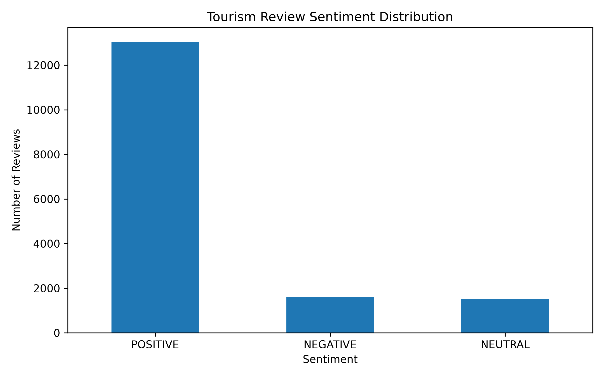
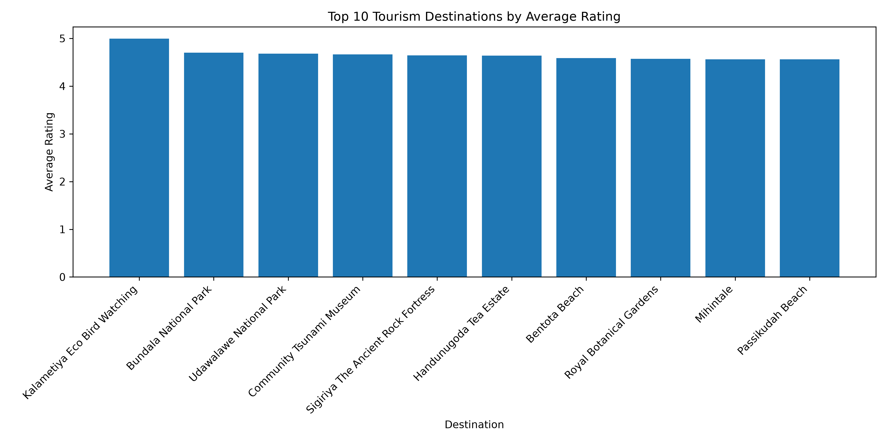

# Tourism Review Analysis

## Project Overview

This project analyzes tourism reviews from Sri Lanka to explore visitor sentiment and compare ratings across tourist destinations. Python is used to process the review dataset, summarize sentiment labels, calculate average destination ratings, and generate visualizations.

## Objectives

- Analyze the distribution of positive, negative, and neutral review labels.
- Calculate average ratings for tourist destinations.
- Identify highly rated destinations in the dataset.
- Present findings through charts and summary tables.

## Technologies Used

- Python
- Pandas
- Matplotlib
- Hugging Face Datasets
- Git and GitHub

## Project Structure

```text
Tourism-Review-Analysis/
├── data/raw/
├── notebooks/
├── outputs/
│   ├── figures/
│   └── tables/
├── report/
├── src/
├── requirements.txt
└── README.md
```

## Key Findings

The dataset contains 16,156 reviews:

- **Positive:** 13,041 (approximately 80.7%)
- **Negative:** 1,602 (approximately 9.9%)
- **Neutral:** 1,513 (approximately 9.4%)

These figures describe the sentiment labels in this dataset and do not necessarily represent all tourists visiting Sri Lanka.

## Visualizations

### Sentiment Distribution



### Top-Rated Destinations



## How to Run

Create and activate a Python virtual environment, then install the required packages:

```bash
python3 -m venv .venv
source .venv/bin/activate
pip install -r requirements.txt
```

Run the analysis scripts in this order:

```bash
python src/download_data.py
python src/analyze_reviews.py
python src/analyze_sentiment.py
python src/visualize_reviews.py
```

## Project Report

See the [project report](report/project_report.md) for the methodology, findings, limitations, and conclusion.

## Limitations

The analysis depends on the available dataset and its existing sentiment labels. Results may not represent every tourist or destination in Sri Lanka.

## Author

Developed as a Python data analysis project for learning and portfolio development.
